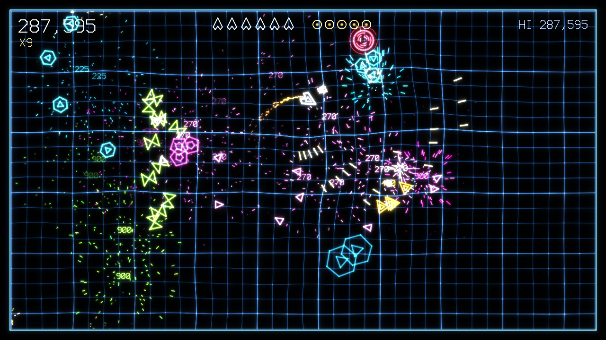
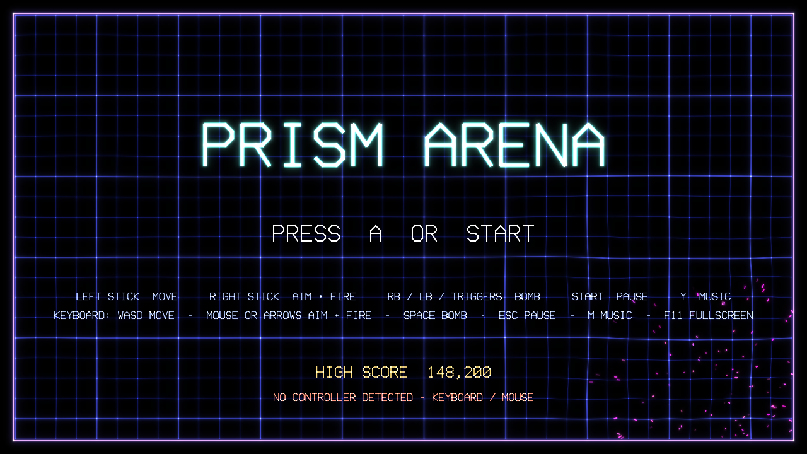
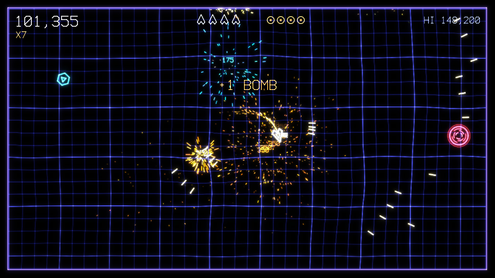
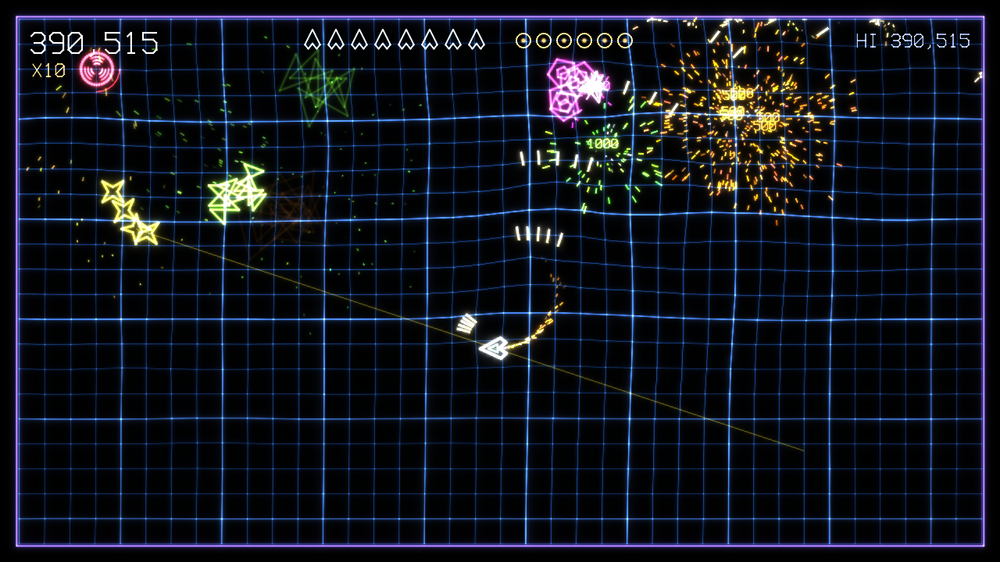

# PRISM ARENA

A neon twin-stick arena shooter in C++17 on SDL3: a port of the Python/pygame
[prism-arena](../prism-arena). It has a spring-mass warping grid, bloom, synthesized sound
effects, and gamepad rumble. On top of the Python version it adds a sequenced music loop and stereo
panning.



| | |
|---|---|
|  |  |
| Title screen | A Singularity (red rings) bending the grid |
|  | |
| Late game: a Lancer lining up its dash | |

## Build & run

SDL3 comes from [Conan](https://conan.io) 2, which builds it and links it in statically. With
CMake (Linux or Windows):

```sh
conan install . --build=missing -s compiler.cppstd=17
cmake --preset conan-release        # on Windows (Visual Studio): cmake --preset conan-default
cmake --build --preset conan-release
build/Release/prism                 # --fullscreen, --no-rumble
```

Or with the Makefile (Linux):

```sh
conan install . --build=missing -of build/conan   # once, or after changing conanfile.py
make && ./prism
```

On Linux, ConanCenter's `xorg/system` package needs the X11/XCB dev headers installed first
(on Ubuntu, the `libx11-dev` and `libxcb-*-dev` packages; `conan install` names any that are
missing). If no Conan build is present, the Makefile uses a system SDL3 (`libsdl3-dev`) instead.

GitHub Actions ([.github/workflows/build.yml](.github/workflows/build.yml)) builds Linux and
Windows binaries on every push and keeps them as workflow artifacts. Pushing a `v*` tag also
publishes them as a GitHub release.

## Controls

| Action | Gamepad | Keyboard / mouse |
|---|---|---|
| Move | Left stick | WASD |
| Aim & fire | Right stick | Hold LMB (aim with mouse) or arrow keys |
| Bomb | LB / RB / LT / RT | Space / RMB |
| Pause | Start | Esc |
| Start / continue | A (or Start) | Enter |
| Quit to title (paused) / quit (title) | Back | Q / Esc |
| Music on/off | Y | M |
| Fullscreen | | F11 / Alt+Enter |
| FPS counter | | F3 |

`--fullscreen` (`-f`) and `--no-rumble` (or `PRISM_NO_RUMBLE=1`) work as in the Python version.

## Enemies

| | |
|---|---|
| Drifter (cyan hexagon) | Wanders around, drifting slowly toward you |
| Seeker (orange arrowhead) | Homes in on you |
| Weaver (lime hourglass) | Zig-zags toward you and sidesteps your bullets |
| Splitter (magenta pentagon) | Takes 2 hits, then shatters into three fast Shards |
| Lancer (yellow star) | Lines up a shot (watch the line), then dashes straight at you |
| Singularity (red rings) | A gravity well that pulls you and bends your shots. Takes 16 hits. Left alone for 22 s, it bursts into eight Shards |

Every kill builds your streak, and the multiplier rises to X10. Dying resets the streak. The gun
upgrades at 25k, 90k and 250k points, up to five streams, and keeps its upgrades when you die. You
get an extra life every 75k and an extra bomb every 100k. A bomb sends out a shockwave that
destroys, and scores, everything it reaches.

## Testing

`--autoplay` lets a bot play. `--shot out.bmp --shot-at 30` saves a frame at 30 s and exits.
Test modes never open the gamepad, so they never rumble it.

## License

MIT. See [LICENSE](LICENSE).
